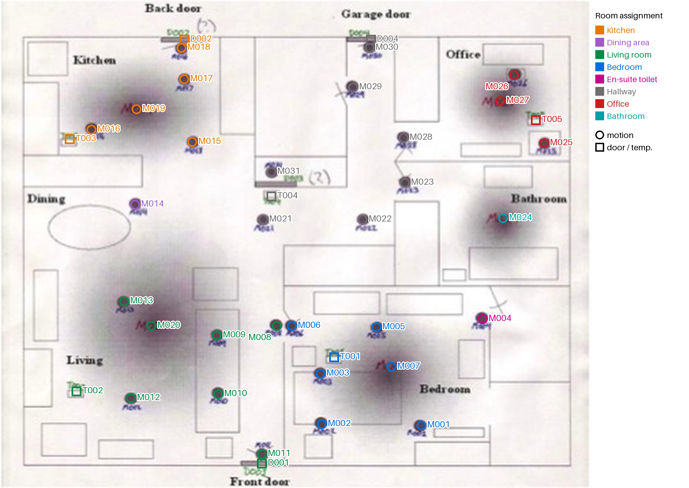

# Step 3: Representation model

The twin service listens to the 39 sensor streams and keeps one current picture
of the home: where the resident is, whether they are at home, which doors are
open, and the temperature of each room. It publishes that picture for the
dashboard and for the machine-learning step.

## Requirements

Derived from the three user groups in the project description.

| User | Needs to know | Model element |
| --- | --- | --- |
| Family caregivers | Is the resident at home, where, and when did they last move? | `resident.presence`, `resident.room`, `resident.inactive_seconds` |
| Care coordinators and healthcare staff | How does the resident move through the home over the day? | `room_entered`, `resident_left`, `resident_returned` transitions (input for Step 4) |
| Facility operators | Are doors open, are room temperatures stable, are sensors healthy? | `doors`, `rooms[].temperature`, `sensors[].invalid_readings` |

General requirements:

1. The state always reflects the most recent sensor reading.
2. The state can be started at any dataset time (the initial situation).
3. Time passing without readings also changes the state (inactivity, leaving home).
4. Garbled readings never corrupt the state.
5. The model only uses information a live system would have. Activity labels are never used.

## The model

Entities and their relations:

```text
Home ──has──> Room (8) ──adjacent to──> Room
               │
               ├──contains──> Motion sensor (31)   spot or whole-room coverage
               ├──contains──> Temperature sensor (5)
               └──contains──> Door sensor (3) ──is──> exit door (front, back, garage)

Resident (1) ──is in──> Room   or is away from home
```

Rooms and sensors are static and defined in `config/home.json`. The room of each
sensor and its position were read from the CASAS floor plan and checked against
the training data: the sensors that fire during each annotated activity are in
the room where that activity happens (for example, 78% of the motion during
Sleeping comes from the two bed sensors M003 and M002).



State variables:

| Entity | Variable | Values | Updated by |
| --- | --- | --- | --- |
| Resident | `presence` | `home`, `away`, `unknown` | motion sensors, exit doors, time |
| Resident | `room`, `since` | one of 8 rooms, or none when away | motion sensors |
| Resident | `inactive_seconds` | time since the last motion | motion sensors, time |
| Resident | `location_unconfirmed_room` | a far room with one unconfirmed motion | motion sensors |
| Home | `possible_second_person` | true or false | motion sensors, time |
| Room | `occupied`, `last_motion`, `active_motion_sensors` | | motion sensors |
| Room | `temperature` (value, age) | degrees Celsius | that room's temperature sensor |
| Door | `state`, `since`, `open_seconds` | `OPEN`, `CLOSE`, `unknown` | door sensor, time |
| Sensor | `value`, `timestamp`, `invalid_readings` | last valid reading | every reading |

The dining area, the bathroom and the en-suite toilet have no temperature
sensor, so their temperature is absent.

Seven room names come from the printed labels on the floor plan. The eighth,
the en-suite toilet behind M004, is unlabelled on the plan and has no sensor
inside. It is inferred from the data: during the 157 Bed_to_Toilet episodes in
the training months, 54% of the motion comes from M004 at its doorway and 44%
from bedroom sensors, while the route to the other bathroom stays silent. After
M004 fires, the next motion is in the bedroom 92% of the time, so the room is a
dead end off the bedroom.

Events and transitions (published on `aruba/twin/events`):

| Transition | Trigger |
| --- | --- |
| `room_entered` | Motion in a room next to the current one, or two motions within 60 s in a room further away |
| `door_opened`, `door_closed` | A door sensor changes value |
| `resident_left` | An exit door was used within 3 minutes of the last motion at that door, followed by 5 minutes without any motion |
| `resident_returned` | Any motion while the resident is away |
| `sensor_invalid_reading` | A reading flagged invalid during data preparation |

## How sensor data feeds the model

- **Motion `ON`** marks the sensor's room as having motion now and resets the
  inactivity timer. If the room is the current one or next to it, the resident
  moves there. If the room is not next to the current one, the model waits for a
  second motion in that room within 60 seconds before moving the resident. One
  isolated motion far away is kept as `location_unconfirmed_room`. Three such
  rejected motions within 10 minutes set `possible_second_person`.
- **Motion `OFF`** only updates the sensor. It never moves the resident.
- **Door `OPEN` or `CLOSE`** updates the door and, for the three exit doors,
  starts the check for leaving home.
- **Temperature** updates the temperature of that sensor's room. Temperature is
  reported only when it changes, so a missing reading means "unchanged" and the
  last value is held. Its age is tracked.
- **Invalid readings** (`value: null`) increase the sensor's invalid count and
  change nothing else.
- **Time** advances between readings. The twin estimates the current dataset
  time from the replay speed, so inactivity and open-door durations keep growing
  and `resident_left` can fire when no sensor is speaking.

## Initial situation

When a replay announces its start time on `aruba/replay/status`, the twin builds
the state for that moment. It loads `initial_state.json` (the last reading of
every sensor before the split starts) and then applies the recorded readings
between the split start and the chosen start time. So doors, temperatures and
the resident's room are already correct when the first live reading arrives.
A sensor with no earlier reading starts as `unknown`.

## Alternatives considered

| Alternative | Why not |
| --- | --- |
| Flat list of sensor values (no rooms, no resident) | Stays at the level of raw measurements. The users ask "where is she?", which no single sensor answers. |
| Occupancy grid or exact x/y position of the resident | Motion sensors only say "something moved in this area". A precise position would claim accuracy the data cannot support. |
| Probabilistic location (hidden Markov model or particle filter over rooms) | Handles noise and several people better, but is harder to explain and to validate in the available time. The adjacency rule captures the main benefit. Listed as future work. |
| Activity state machine as the core model | Activities are not directly sensed. They are inferred in Step 4 and added on top of this model, in the `activity` field. |
| Ontology or knowledge graph (for example SOSA/SSN, Brick) | Good for integrating many homes and vendors. For one home with 39 sensors it adds tooling without adding information. The JSON layout keeps the same entities and relations. |

The chosen model is a small entity-relation model with rooms as the unit of
location. Room level matches the precision of the sensors, the vocabulary of the
users and the floor-plan visualisation.

## Fidelity

`twin/evaluate.py` runs the model over a split without a broker. It compares the
resident's room with the room each annotated activity takes place in, weighted
by time, and compares presence with the annotated trips out of the house. The
labels are used only for this comparison.

| Split | Annotated hours | Room agreement | Baseline (last motion only) | Away time detected | Home time wrongly "away" |
| --- | ---: | ---: | ---: | ---: | ---: |
| Train (Nov to Mar) | 2,395 | 97.0% | 96.7% | 94.6% | 0.07% |
| Validation (Apr) | 484 | 95.8% | 95.0% | 95.6% | 0.14% |

The model's time constants were chosen on these two splits. Run the same command
on the replay split for the final report figure.

Most disagreement is during Meal_Preparation and Eating, when the resident moves
between kitchen and dining area inside one annotated activity.

## Limitations

- **One resident.** The model tracks a single person. Visitors make motion appear
  in several rooms. The model then keeps the last confirmed room and raises
  `possible_second_person`, but it cannot say who is where.
- **The bathroom sensor M024** fires during many activities elsewhere in the
  home (6% of the motion during Sleeping). The adjacency rule filters most of
  this. The cause is unknown.
- **The en-suite toilet** has no sensor inside. M004 at its doorway stands in
  for it, so the resident shows as "en-suite toilet" from the moment M004 fires
  until a bedroom sensor fires. Someone passing the doorway inside the bedroom
  also triggers it. Agreement with the Bed_to_Toilet annotations is 86% of the
  annotated time on the train split and 97% on validation. Whether the resident
  uses the other bathroom during the day cannot be checked, because no daytime
  toilet activity is annotated.
- **Leaving home** is inferred, since nothing senses the outside. A short trip
  under 5 minutes is not detected, and "away" is reported 5 minutes late (the
  transition carries the time of the actual exit).
- **Sensor positions** were read by hand from a low-resolution floor plan and
  are accurate to about 5 pixels.

## Run it (macOS)

Four terminals, each in the repository root with `source .venv/bin/activate`.

```sh
# Terminal 1: broker
mosquitto -c mosquitto/mosquitto.conf

# Terminal 2: the twin
python twin/twin.py

# Terminal 3: live view of the twin's state
python twin/watch.py

# Terminal 4: replay a morning, six hours in six minutes
python replay/replay.py --start 2011-05-01T06:00:00 --end 2011-05-01T12:00:00 --speed 60
```

Terminal 2 prints each transition. Terminal 3 shows the resident's room, the
room temperatures and the doors, updating as the replay runs.

Without a broker:

```sh
python twin/evaluate.py --split validation      # fidelity figures
python -m unittest discover tests               # 24 tests
```

## Topics

| Topic | Content | Retained |
| --- | --- | --- |
| `aruba/twin/state` | The complete state as one JSON document, at most five times per second and at least once per second during a replay | yes |
| `aruba/twin/events` | One JSON message per transition | no |

`aruba/twin/state` is the only topic the dashboard needs. The fields `activity`
and `alerts` are present and empty until Step 4 fills them.
